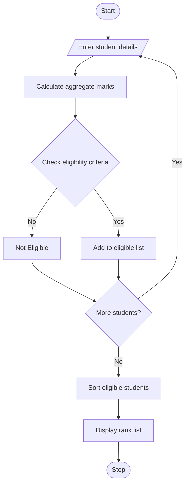

# 1. University Scholarship Allocation System

## 1. Problem Statement

Develop a Python program to select eligible students for university scholarships based on aggregate marks, minimum subject marks, attendance percentage, and annual family income. The program ranks eligible students and resolves ties using attendance, income, and student ID.

## 2. Algorithm

1. Start the program.
2. Input the number of students.
3. Enter each student's ID, name, subject marks, attendance, and annual income.
4. Calculate the aggregate percentage.
5. Check all eligibility criteria.
6. If all criteria are satisfied, add the student to the eligible list; otherwise, mark the student as not eligible.
7. Sort eligible students by aggregate marks (descending), attendance (descending), income (ascending), and student ID (alphabetical).
8. Display the eligibility status and rank list.
9. Stop.

## 3. Flowchart (Mermaid)

## 5. Sample Input

```
Enter number of students: 2

Student 1
Student ID: S101
Name: Ravi
Python marks: 90
Maths marks: 85
English marks: 95
Attendance: 90
Annual family income: 200000

Student 2
Student ID: S102
Name: Anu
Python marks: 95
Maths marks: 90
English marks: 95
Attendance: 95
Annual family income: 180000
```

## 6. Sample Output

```
Scholarship Rank List
Rank  ID     Name     Aggregate
1 S102 Anu 93.33
2 S101 Ravi 90.0
```


    
