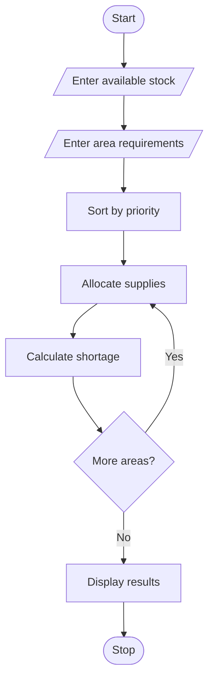

# Disaster Relief Supply Allocation Using Python
## 1.problem statment
 Disaster Relief Supply Allocation: Compare stock lists against area-wise requirements, prioritize 
urgent shortages, allocate limited supplies according to a prescribed policy, and calculate remaining 
unmet demand. 
## 2. Algorithm

1. Start.
2. Enter available stock.
3. Enter the number of affected areas.
4. Enter area name, required supplies, and priority.
5. Sort areas according to priority.
6. Allocate available supplies.
7. Calculate shortage.
8. Display allocated supplies and remaining stock.
9. Stop.

## 3. Flowchart Using Mermaid


## 5. Sample Input

```
Enter available stock: 100
Enter number of areas: 2

Enter area name: Guntur
Enter required supplies: 80
Enter priority: 1

Enter area name: Vijayawada
Enter required supplies: 50
Enter priority: 2
```

## 6. Sample Output

```
Allocation Report

Area: Guntur
Allocated: 80
Shortage: 0

Area: Vijayawada
Allocated: 20
Shortage: 30

Remaining Stock: 0
```

