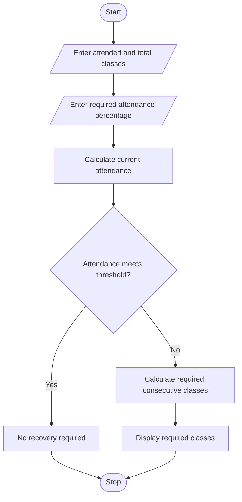

# 2. Attendance Recovery Computation Using Python

## 1. Problem Statement

Develop a Python program to calculate a student's current attendance percentage and determine the minimum number of consecutive classes the student must attend to reach the required attendance threshold. The program also considers future classes that the student may attend or miss.


## 2. Algorithm

1. Start the program.
2. Input the number of classes attended and total classes conducted.
3. Input the required attendance percentage.
4. Calculate the current attendance percentage.
5. If current attendance meets the threshold, display that no recovery is required.
6. Otherwise, calculate the minimum consecutive classes that must be attended to reach the threshold.
7. Display the current attendance and required classes.
8. Stop.

## 3. Flowchart Using Mermaid

## 5. Sample Input

```
Enter classes attended: 60
Enter total classes: 80
Enter required attendance percentage: 75
```

## 6. Sample Output

```
Current attendance: 75.0 %
Attendance requirement already satisfied
Additional classes required: 0
```

