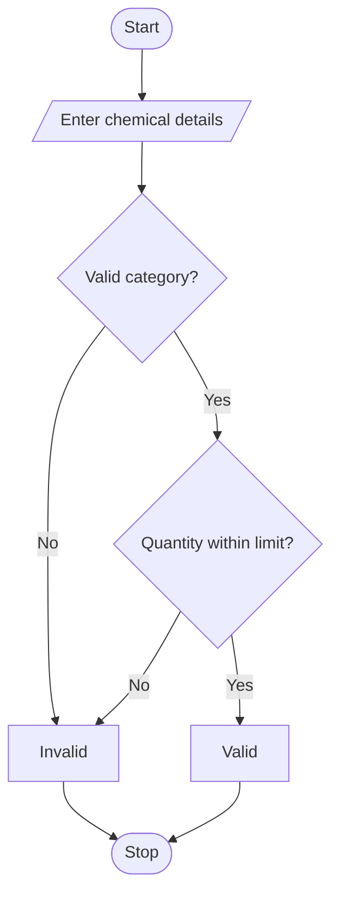

# Laboratory Chemical Inventory Validation

## 1. Algorithm

1. Start.
2. Enter the number of chemicals.
3. Enter chemical name, category, and quantity.
4. Check whether the category is valid.
5. Check whether the quantity is within the limit.
6. Check incompatible categories.
7. Display Valid or Invalid.
8. Stop.

## 2. Flowchart (Mermaid)



## 4. Sample Input

```
Enter chemical name: Petrol
Enter category: Flammable
Enter quantity: 30
```

## 5. Sample Output

```
Chemical Inventory Validation
Chemical Inventory is Valid
```

## 6. Conclusion

This simple Python program checks chemical categories and maximum quantity limits and displays the inventory validation result.
