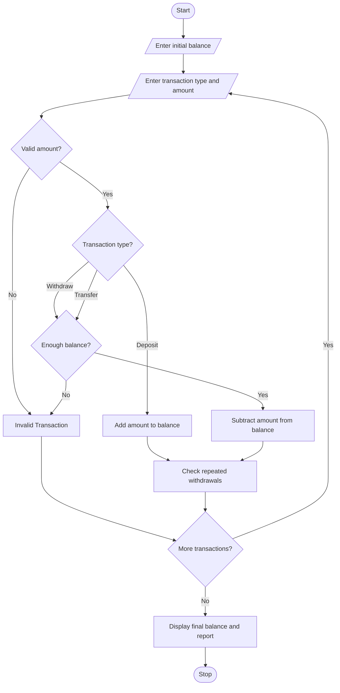

# Multi-Stage ATM Transaction Audit Using Python

## 1. Problem Statement
 Multi-Stage ATM Transaction Audit: Process a sequence of deposits, withdrawals, and transfers 
in a simulated account, maintain balances, detect invalid operations, and report suspicious repeated 
patterns. 
## 2. Algorithm

1. Start the program.
2. Enter the initial account balance.
3. Enter the number of transactions.
4. Select the transaction type.
5. Enter the transaction amount.
6. Check whether the amount is valid.
7. Process deposit, withdrawal, or transfer.
8. Update the account balance.
9. Detect repeated withdrawals.
10. Display invalid transactions and suspicious patterns.
11. Display the final balance.
12. Stop the program.

## 3. Flowchart Using Mermaid


## 5. Sample Input

```
Enter initial balance: 10000
Enter number of transactions: 4

Transaction 1
Enter your choice: 1
Enter amount: 2000

Transaction 2
Enter your choice: 2
Enter amount: 1000

Transaction 3
Enter your choice: 2
Enter amount: 500

Transaction 4
Enter your choice: 2
Enter amount: 500
```

## 6. Sample Output

```
ATM Transaction Audit System

Deposit Successful
Current Balance: 12000

Withdrawal Successful
Current Balance: 11000

Withdrawal Successful
Current Balance: 10500

Withdrawal Successful
Warning: Suspicious Repeated Withdrawals!
Current Balance: 10000

Final Account Balance: 10000
ATM Audit Completed
```

## 7. Conclusion

The Multi-Stage ATM Transaction Audit program processes deposits, withdrawals, and transfers. It updates account balances, identifies invalid transactions, and detects suspicious repeated withdrawal patterns. It helps understand basic ATM transaction management using Python.
